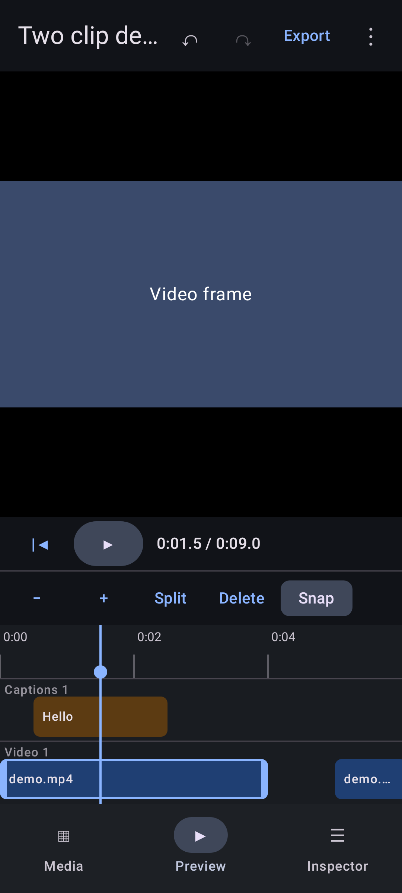
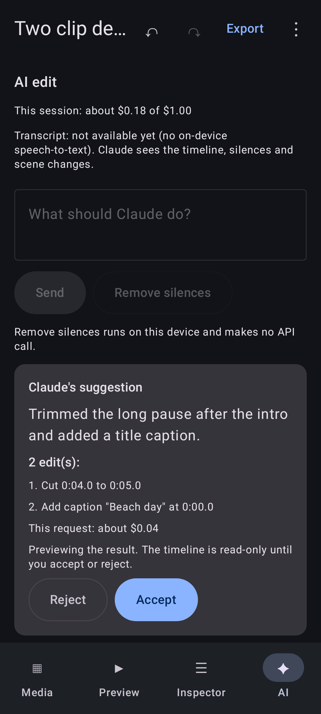
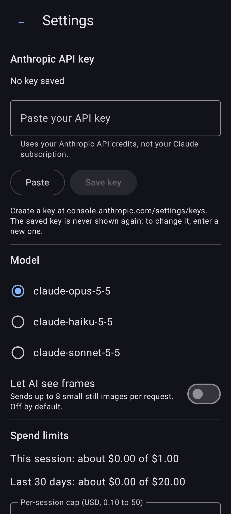
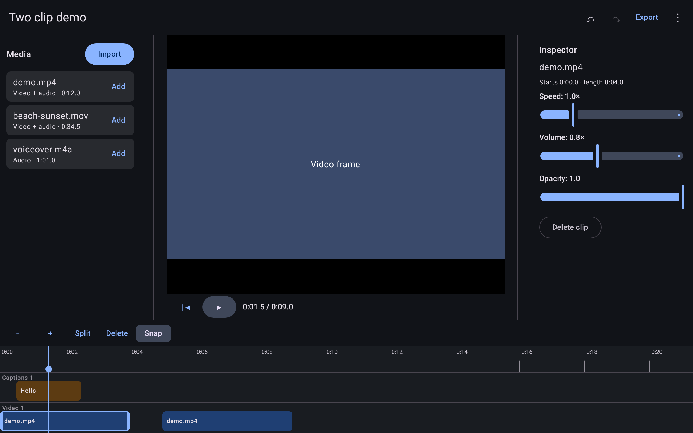

# Handoff: Open Video Editor overnight build

## What works / What's stubbed or device-untested

Works (JVM-tested):
- `:core:timeline` engine: project model, strict commands, undo/redo, JSON, generated schemas (65 tests).
- `:core:ai`: key format check, spend guard, Claude edit assistant against a mock server (101 tests).
- `:core:mcp`: `vedit-mcp` stdio server with 10 tools; offline mode driven by real Claude Code (listed clips, split a clip).
- Render plan and Media3 composition mapping logic; UI shell and view-model logic; JVM screenshots.

Device-untested (no emulator or device was available):
- Media3 preview and export runtime code. Known gaps: output fps not applied, clip position offset ignored on single-track output, still images refused.
- Compose UI on a real device (phone tabs, tablet and laptop panes, gestures, shortcuts).
- Android Keystore key cipher and the spend ledger store.
- Phone-side MCP bridge: abstract socket, `adb forward` to it, peer-UID check, pairing UI (design risk R2 in security.md).
- The app's AI path with a real key (only the manual `manual-real-api` test exists, not run).

Stubbed or not built:
- Transcript: stub (`NoTranscriptAvailable`), shown in the UI. Scene detection limited to sync-frame spacing.
- QR pairing, visible 60 s pairing countdown, MCP undo tool, bridge transcript (unsupported).
- Claude app custom connectors (need public HTTPS + OAuth).
- Sample project media is not bundled, so export is blocked on the sample.
- Key field lacks IME no-personalized-learning/autofill exclusion; export is not blocked while an AI suggestion is pending.
- Cosmetic: large letterbox on the phone preview; "Delete clip" below the fold in the inspector sheet.

## How to build and install the APK

```sh
export JAVA_HOME=$HOME/.local/jdk/jdk-17.0.21+9 ANDROID_HOME=$HOME/Android/Sdk   # JDK 17, Android SDK 37
./gradlew :app:assembleDebug --console=plain
adb install -r app/build/outputs/apk/debug/app-debug.apk
```

Tests: `./gradlew test`. Style: `./gradlew ktlintCheck`. Enable hooks: `git config core.hooksPath .githooks`.

## How to add the API key

Create a Console API key at console.anthropic.com (use a workspace with a spend limit). In the app: Settings,
AI section, paste the key, set the per-session and rolling 30-day spend caps (defaults $1 and $20), pick a model (default `claude-opus-5-5`).
Uses your Anthropic API credits, not your Claude subscription. There is no Claude.ai login, and `sk-ant-oat...`
subscription tokens are rejected.

## How to connect via MCP

Claude Code, phone attached (device-untested on the phone side):
1. `./gradlew :core:mcp:installDist` (launcher at `core/mcp/build/install/vedit-mcp/bin/vedit-mcp`).
2. In the app: menu, Claude Code (MCP), switch on Allow MCP control (off after every restart).
3. `adb forward tcp:47821 localabstract:dev.videoeditor.app.bridge`
4. In the app tap Show pairing code, then run `vedit-mcp pair`, type the 8-digit code, tap Allow on the phone within 60 s.
5. `claude mcp add vedit -- <path>/bin/vedit-mcp stdio`

Offline mode (no phone, verified with real Claude Code):
```sh
vedit-mcp sample-project demo.json
claude mcp add vedit-offline -- <path>/bin/vedit-mcp stdio --project demo.json
```
Full details: [docs/mcp.md](docs/mcp.md).

## License risks

Project is Apache-2.0. [LICENSE_AUDIT.md](LICENSE_AUDIT.md) found no GPL, LGPL, AGPL or ffmpeg artifact; overall risk low. Uncertain items (all permissive under every reading, none copyleft):
1. Jackson datatype-jdk8 / jsr310 2.19.4: POMs lack a license block; Apache-2.0 inferred from sibling artifacts.
2. ktlint-gradle 14.2.0 (build-only): MIT read from GitHub master LICENSE, not the release tag.
3. slf4j-api, guava (android), failureaccess, listenablefuture: no POM license block; read from upstream master.
4. MCP kotlin-sdk: not used. If added, MIT vs Apache-2.0 transition needs a decision.
5. victools 4.38.0: Apache-2.0 rests on the parent POM only.
Also: JUnit (EPL, test-only, not shipped). Not a license issue: kotlin-stdlib resolves to 14 versions.

## Model usage summary

From [MODEL_LOG.md](MODEL_LOG.md) (19 logged tasks):
- Fable 5.2 (architect): 2 design docs (security.md, timeline.md), about 2 of 19 tasks. Will also do the final review (Phase 8).
- Opus 5.5 (builder, at medium effort): the bulk of implementation, 10 tasks (timeline engine, key store, Media3, UI shell, AI client, AI wiring, MCP), roughly half of the tasks and most of the tokens (about 200k to 270k tokens per large task). The orchestrator role (Opus) also did setup and 1 small security fix.
- Sonnet 5.5 (worker): 3 tasks (scaffold and CI, property tests plus trim fix, JVM screenshots), plus this README/HANDOFF pass. About 15 to 20 percent.
- Haiku 5.5 (scout): 2 tasks (license audit and its refresh). About 10 percent.
- Incident: around 22:05 IST on 2026-11-13 the account hit its 5-hour usage limit (HTTP 429, resets 22:10 IST) while two Opus builders ran. It was account-wide, so no model fallback applied. Partial work stayed on disk and the agents resumed after the reset. Afterwards Opus builders ran at medium effort and one task at a time to cut token use. Shares are approximate task counts, not measured tokens.

## Top 5 next steps

1. On-device test pass of everything marked device-untested: Media3 preview/export, Keystore cipher, the MCP bridge (verify R2: `adb forward ... localabstract:` and peer UID 2000 on real API 26 and 37 devices), and the UI on phone and tablet.
2. Fix known gaps from DECISIONS: output fps, clip position offset on single-track export, still image support, export block during a pending AI suggestion, IME flags on the key field.
3. Real transcript through on-device speech-to-text, replacing the `NoTranscriptAvailable` stub (also feeds `get_transcript` over MCP).
4. QR pairing with a visible countdown, plus an MCP undo tool, to finish the pairing UX that is currently code-only.
5. Run the manual real-key test and an end-to-end AI session, then later a Claude app connector via a remote HTTPS endpoint with OAuth (the only safe route for claude.ai connectors).

## Screenshots

<table>
  <tr>
    <td align="center"></td>
    <td align="center"></td>
    <td align="center"></td>
  </tr>
</table>



JVM renders from fake state, not device captures.

## Push status

- Branch: `overnight/build-20261113`
- Last commit: `<<LAST_COMMIT>>`
- Push succeeded: `<<PUSH_STATUS>>`
- The remote currently has only `overnight/build-20261113`; there is no `main` branch yet (`git ls-remote --heads origin`). A `main` branch must be created first (for example from the initial commit) before a PR can be opened. It was intentionally not created here.
- PR command, once `main` exists:
  ```sh
  gh pr create --base main --head overnight/build-20261113 --title "Overnight build: video editor scaffold" --body-file HANDOFF.md
  ```
- Compare URL: https://github.com/tkrupesh14/videoeditor/compare/main...overnight/build-20261113
