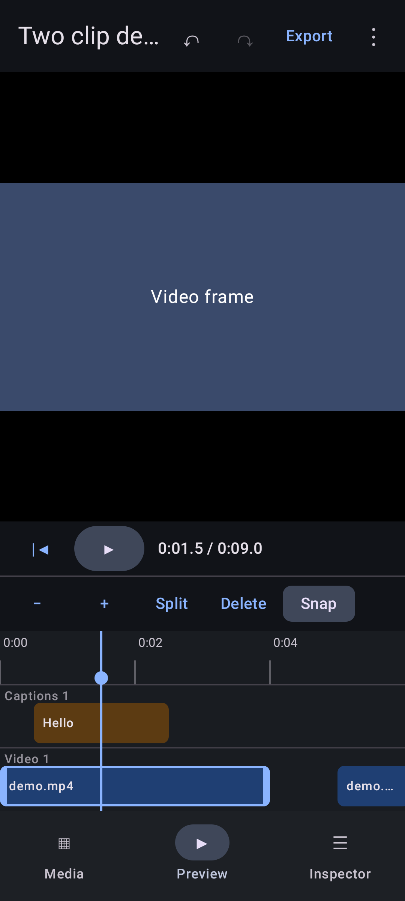
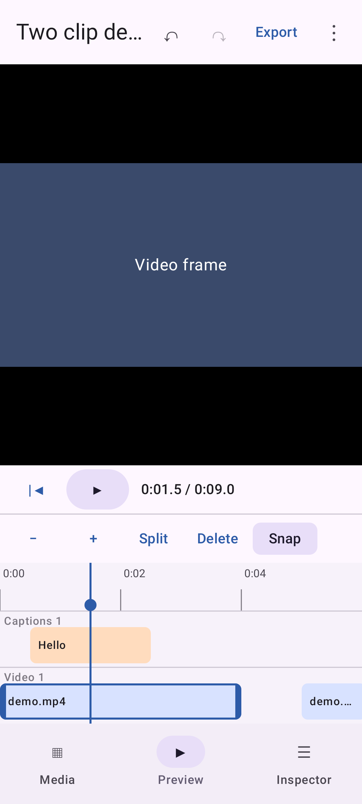
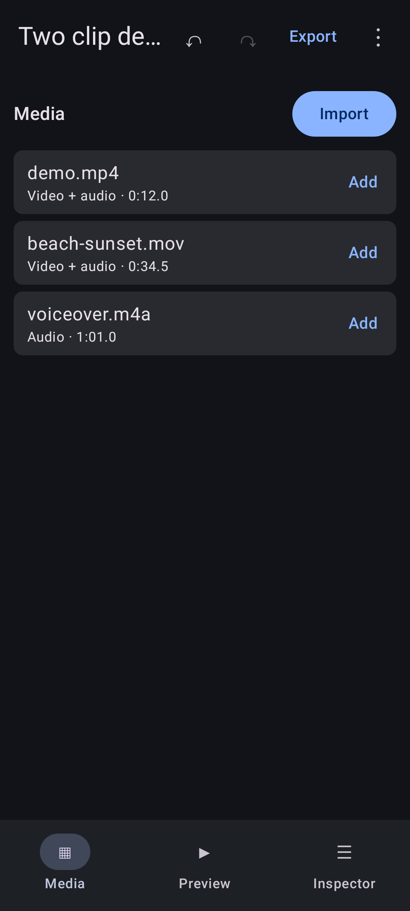
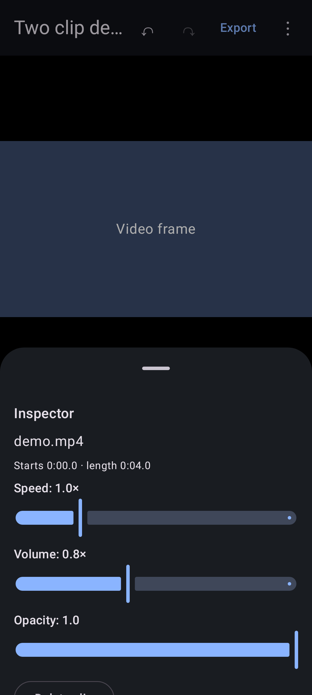
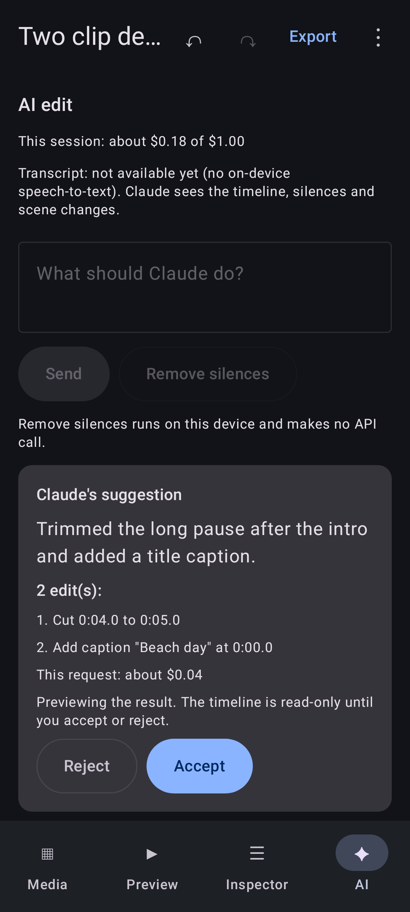
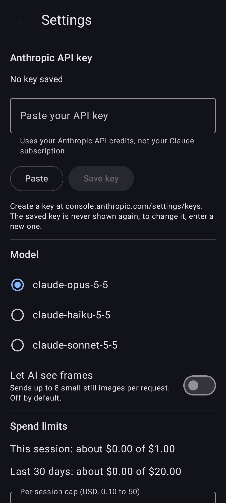
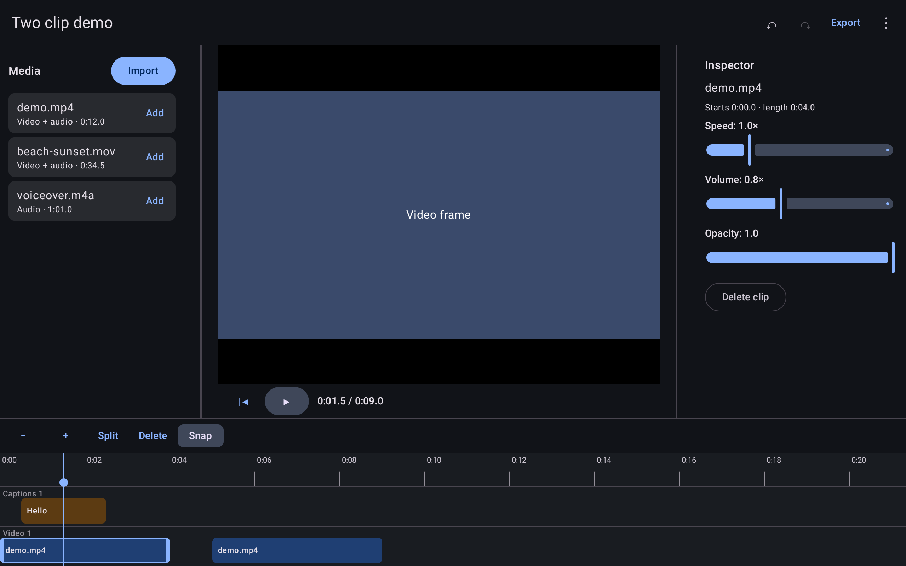
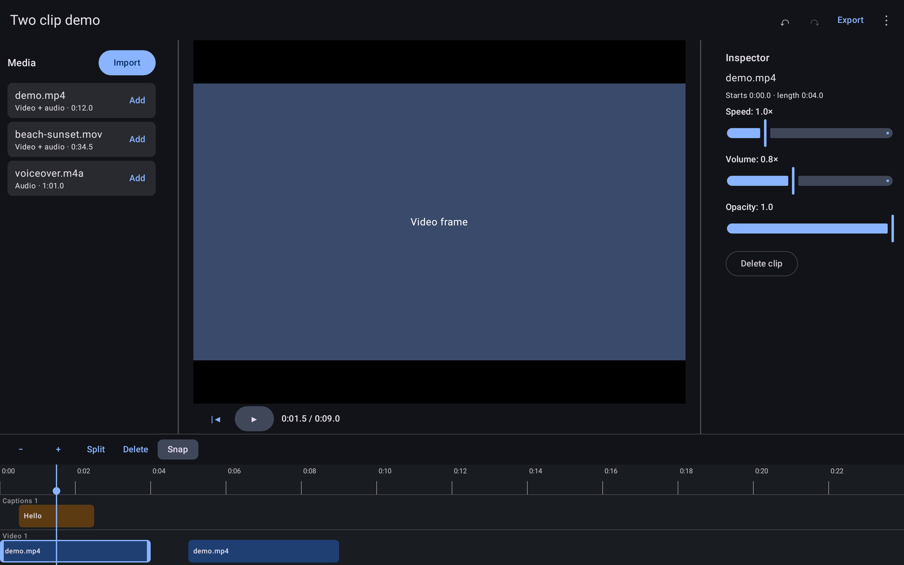
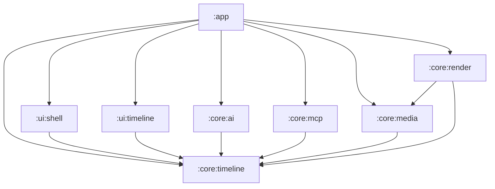
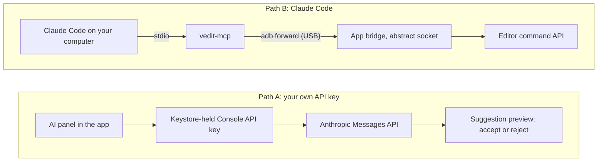

# Open Video Editor

An open-source, AI-assisted video editor for Android. It is phone-first (bottom tabs plus an inspector sheet) and
switches to a multi-pane layout on tablets and laptops (media, preview, inspector, timeline, with draggable
splitters and keyboard shortcuts). Editing runs on a pure-Kotlin timeline engine with undo/redo; preview and
export use Media3. Two optional AI paths can edit the timeline for you, both through the same command API.

**Status: scaffold built overnight with no emulator or physical device.** Everything that runs on the JVM is
tested. Everything that needs Android runtime (Media3 playback and export, Keystore, the MCP bridge socket) has
never been run on a device. See [Feature status](#feature-status).

## Screenshots

Rendered on the JVM with Roborazzi and Robolectric (no emulator), from fake state. The video surface is a
placeholder box in these images.

<table>
  <tr>
    <td align="center"><br>Preview (dark)</td>
    <td align="center"><br>Preview (light)</td>
    <td align="center"><br>Media</td>
    <td align="center"><br>Inspector sheet</td>
  </tr>
  <tr>
    <td align="center"><br>AI panel</td>
    <td align="center"><br>AI settings</td>
  </tr>
</table>

Tablet and laptop layouts:





## Feature status

| Feature | Status |
|---|---|
| Timeline engine: tracks, clips, split, trim, move, delete, captions, ripple cuts, undo/redo, JSON project format | Works. JVM-tested (65 example and property tests). |
| Command API and generated JSON schemas (shared by UI, AI and MCP) | Works. JVM-tested, golden schemas. |
| Media probe, thumbnails, render plan, Media3 composition mapping | Plan and mapping JVM-tested. Media3 runtime code is device-untested. |
| Preview playback and export (Media3 CompositionPlayer / Transformer) | Device-untested. Known gaps: output fps not applied, clip position offset ignored on single-track output, still images refused. |
| Responsive UI shell (phone tabs, tablet and laptop panes, shortcuts, autosave, import, export dialog) | Compose UI and view-model logic JVM-tested. Device-untested. |
| API key storage (Android Keystore) and spend caps | Logic JVM-tested. The Keystore cipher is device-untested. |
| AI editing with your own key (Claude Messages API, tool use, accept/reject, "Remove silences") | JVM-tested against a mock server. Never run with a real key from the app. A manual real-key test exists. |
| AI transcript | Stubbed. The UI reports that no transcript is available. |
| Scene detection | Limited to sync-frame spacing. |
| MCP server `vedit-mcp` (10 tools, resources, offline mode) | Works. JVM-tested. Offline mode was driven by real Claude Code (list clips, split). |
| Phone-side MCP bridge (pairing, HMAC auth, `adb forward`) | JVM/protocol-tested only. Device-untested. |
| QR pairing, visible pairing countdown, MCP undo tool | Not built. `vedit-mcp pair` with a typed code works in design. |
| Claude app custom connectors | Not supported in v1. |

Known gaps are tracked in [DECISIONS.md](DECISIONS.md) and [BLOCKERS.md](BLOCKERS.md).

## Architecture

Eight Gradle modules. Edges below are the `project(...)` dependencies in each `build.gradle.kts`.



- `:core:timeline` is pure Kotlin. It holds the project model, the strict command API, undo/redo and the JSON
  schemas. Everything else edits through it.
- `:core:ai` is pure JVM: key handling, spend guard, and the Claude edit assistant (official Anthropic Java SDK).
- `:core:mcp` is the `vedit-mcp` stdio MCP server and the bridge client.
- `:core:media` and `:core:render` wrap Media3 for probing, preview and export.
- `:ui:shell` and `:ui:timeline` are the Compose UI. `:app` wires everything and hosts the phone-side bridge.

### The two AI paths



Path A calls the Claude Messages API directly from the phone with your key. Path B runs `vedit-mcp` on your
computer as a stdio MCP server for Claude Code; it reaches the phone over `adb forward` to an app-owned
abstract socket. The app never listens on a network interface. Design and threat model:
[docs/design/security.md](docs/design/security.md).

## Build & install

Requirements: JDK 17, Android SDK with platform 37 (set `ANDROID_HOME`).

```sh
export JAVA_HOME=/path/to/jdk-17 ANDROID_HOME=$HOME/Android/Sdk
./gradlew :app:assembleDebug
adb install -r app/build/outputs/apk/debug/app-debug.apk
```

The app requires Android 8.0 (API 26) or newer.

## Add your API key

AI features in the app need an Anthropic Console API key.

1. Create a key in the [Anthropic Console](https://console.anthropic.com). Ideally use a workspace with its
   own spend limit.
2. In the app open Settings, then the AI section, and paste the key.
3. Set the spend caps there (per session and rolling 30 days; defaults $1 and $20) and pick a model. Cheaper models are available in the picker.

**Uses your Anthropic API credits, not your Claude subscription.** The app never asks for a Claude.ai login,
and keys that look like subscription OAuth tokens (`sk-ant-oat...`) are rejected. The key is stored with the
Android Keystore and is not part of backups. The default model is `claude-opus-5-5`.

## Connect Claude Code via MCP

You can drive the editor from Claude Code on a computer the phone is plugged into. In short: build the
launcher with `./gradlew :core:mcp:installDist`, turn on "Allow MCP control" in the app, run
`adb forward tcp:47821 localabstract:dev.videoeditor.app.bridge`, pair once with `vedit-mcp pair`, then
`claude mcp add vedit -- <path>/bin/vedit-mcp stdio`. Full steps, security behavior and offline mode:
[docs/mcp.md](docs/mcp.md). The phone side is device-untested.

Claude app custom connectors (claude.ai / mobile) are not supported in v1. They need a public HTTPS endpoint
with OAuth, and offering an unauthenticated endpoint would allow anyone to remote-control your phone. Adding
an authenticated remote endpoint is the path forward.

## Sample project

The app has a built-in sample project (two-clip demo). Its media files are not bundled, so on a device the
app shows a "media missing" state and blocks export. For MCP offline mode you can write the same sample as a
JSON file:

```sh
core/mcp/build/install/vedit-mcp/bin/vedit-mcp sample-project demo.json
claude mcp add vedit-offline -- core/mcp/build/install/vedit-mcp/bin/vedit-mcp stdio --project demo.json
```

## Testing

```sh
./gradlew test                              # all JVM unit and property tests
./gradlew :app:recordRoborazziDebug         # regenerate docs/screenshots/*.png
./gradlew ktlintCheck                       # style
```

- AI tests use a local mock server and never reach the network or spend credits.
- Screenshots are JVM renders (Robolectric at SDK 35), see [docs/screenshots/README.md](docs/screenshots/README.md).
- A manual real-key test is tagged `manual-real-api` and excluded from `test`. It spends a fraction of a cent;
  see [core/ai/README.md](core/ai/README.md).
- There are no instrumented device tests yet.

## Contributing

Enable the repo hooks once (secret scan on commit and push):

```sh
git config core.hooksPath .githooks
```

Code style is ktlint (`./gradlew ktlintCheck`). Keep decisions in [DECISIONS.md](DECISIONS.md). Never commit
API keys; `scripts/secret-scan.sh` runs in CI too.

## License

Apache License 2.0, see [LICENSE](LICENSE) and [NOTICE](NOTICE). Dependency licenses were audited and none are
copyleft in the shipped tree: [LICENSE_AUDIT.md](LICENSE_AUDIT.md).
